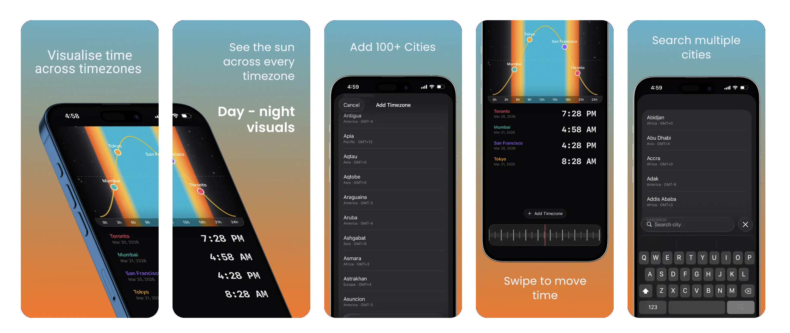

# Timezone

An iOS and macOS app for visualising time across multiple timezones by sunrise and sunset.

Instead of just listing clocks, Timezone draws a 24-hour sun arc and places each city as a colored dot along its day-night cycle — so you can see at a glance who is in daylight, who is asleep, and who is somewhere in between.

**Download:** [Sun Timezone on the App Store](https://apps.apple.com/us/app/sun-timezone/id6760567372)

<p align="center">
  
</p>

## Features

- **Sun path chart** — a sine-wave arc shows day and night; each timezone is a colored dot positioned by local hour.
- **Scrubbing dial** — swipe the dial at the bottom to fast-forward or rewind, and watch all your cities shift together.
- **Adaptive layout** — compact iPhone view stacks chart, list, and dial vertically; iPad regular view splits chart + dial on the left and the list on the right.
- **Mac app** — native macOS window with a sidebar listing your cities and a search field to add more, the sky chart and dial filling the rest, and menu bar commands.
- **Widgets** — a Sun Arc widget for the Home Screen and Mac desktop (small, medium, large) with buttons to step time forward or back, plus Lock Screen widgets. Each widget can follow the app's list or show its own cities.
- **100+ cities** — full IANA timezone database plus aliases for popular cities not in IANA (Mumbai, Beijing, San Francisco, Vancouver, etc.).
- **Color-coded entries** — each timezone gets a distinct color so it's easy to track on both the chart and the list.
- **Animated sky** — gradient background with stars that fades with the sun.
- **Local only** — selections are saved on-device. No accounts, no tracking, no network.

## Tech

- SwiftUI
- Swift `Canvas` for the sun path chart and dial
- `TimeZone` / `DateFormatter` for IANA timezone resolution
- `UserDefaults` in an App Group for persistence shared with widgets
- WidgetKit and App Intents for configurable, interactive widgets

## Project Structure

```
timezone/                     # App (iOS + macOS)
├── timezoneApp.swift         # App entry point
├── ContentView.swift         # Root view; compact, regular and Mac layouts
├── MacCommands.swift         # Menu bar commands (macOS)
├── SunPathChart.swift        # Sine-wave sun arc with timezone markers
├── DialView.swift            # Scrubbable time dial (drag, scroll, haptics)
├── TimezonePickerView.swift  # City search and picker
└── TimezoneRow.swift         # Row UI in the timezone list
Shared/                       # Compiled into the app and the widgets
├── TimezoneStore.swift       # App Group persistence
├── TimezoneHelpers.swift     # Time math and position calculations
├── SkyGradientView.swift     # Sky background
├── Models.swift              # TimezoneEntry, TimezoneData, etc.
└── Constants.swift           # Colors, city aliases, picker items
timezoneWidgets/              # Widget extension
├── TimezoneWidgetBundle.swift
├── SunArcWidget.swift        # Home Screen / desktop widget and scrub buttons
├── LockScreenWidgets.swift   # Accessory widgets (iOS)
├── WidgetTimeline.swift      # Timeline entries and provider
└── WidgetIntents.swift       # City configuration and time-shift intents
```

## Build

Requires Xcode 26+; targets iOS 26.2 and macOS 26.

```bash
open timezone.xcodeproj
```

Build and run the `timezone` scheme on an iPhone simulator, a device, or My Mac.

## Support

Support site, FAQ, and privacy policy: [timezone.arshwaraich.com](https://timezone.arshwaraich.com)

For questions: [work@arshwaraich.com](mailto:work@arshwaraich.com)

## Privacy

Timezone does not collect, store, or transmit any personal data. Your selected cities are saved locally on your device. The app does not request location and does not include any third-party analytics or tracking.
