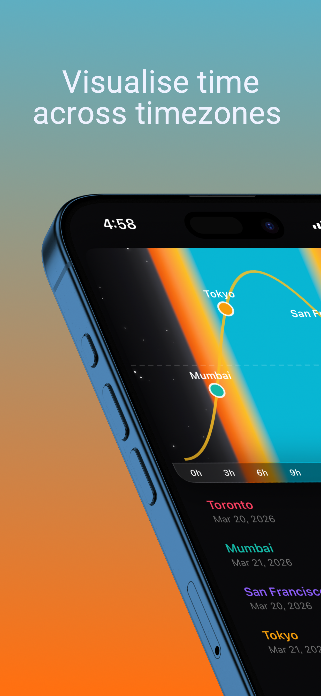
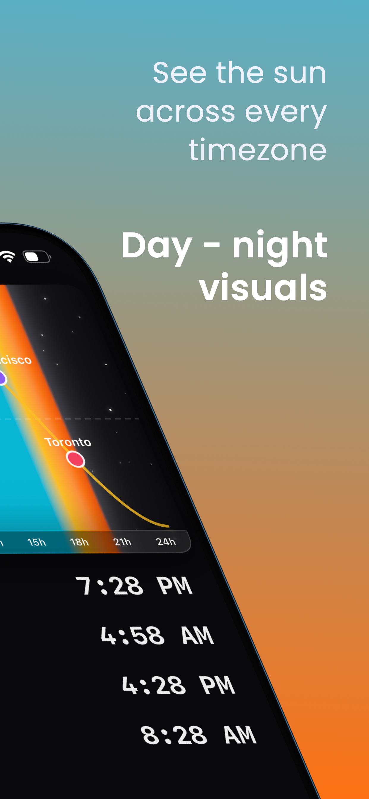
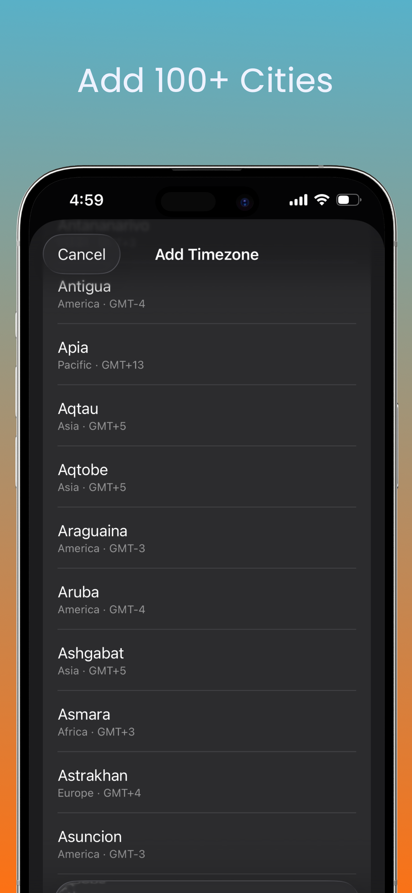
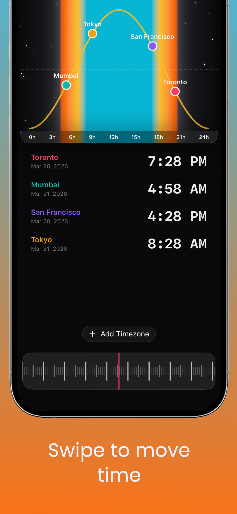
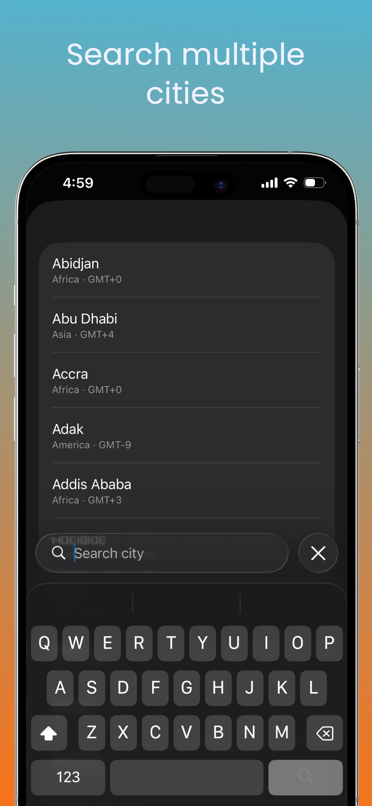

# Timezone

An iOS app for visualising time across multiple timezones by sunrise and sunset.

Instead of just listing clocks, Timezone draws a 24-hour sun arc and places each city as a colored dot along its day-night cycle — so you can see at a glance who is in daylight, who is asleep, and who is somewhere in between.

**Download:** [Sun Timezone on the App Store](https://apps.apple.com/us/app/sun-timezone/id6760567372)

<p align="center">
  
  
  
  
  
</p>

## Features

- **Sun path chart** — a sine-wave arc shows day and night; each timezone is a colored dot positioned by local hour.
- **Scrubbing dial** — swipe the dial at the bottom to fast-forward or rewind, and watch all your cities shift together.
- **Adaptive layout** — compact iPhone view stacks chart, list, and dial vertically; iPad regular view splits chart + dial on the left and the list on the right.
- **100+ cities** — full IANA timezone database plus aliases for popular cities not in IANA (Mumbai, Beijing, San Francisco, Vancouver, etc.).
- **Color-coded entries** — each timezone gets a distinct color so it's easy to track on both the chart and the list.
- **Animated sky** — gradient background with stars that fades with the sun.
- **Local only** — selections are saved on-device. No accounts, no tracking, no network.

## Tech

- SwiftUI
- Swift `Canvas` for the sun path chart and dial
- `TimeZone` / `DateFormatter` for IANA timezone resolution
- `UserDefaults` for local persistence

## Project Structure

```
timezone/
├── timezoneApp.swift       # App entry point
├── ContentView.swift       # Root view, compact + regular layouts
├── SunPathChart.swift      # Sine-wave sun arc with timezone markers
├── DialView.swift          # Scrubbable time dial with haptic ticks
├── SkyGradientView.swift   # Animated sky background
├── TimezonePickerView.swift# City search and picker
├── TimezoneRow.swift       # Row UI in the timezone list
├── TimezoneHelpers.swift   # Time math and position calculations
├── Models.swift            # TimezoneEntry, TimezoneData, etc.
└── Constants.swift         # Colors and city aliases
```

## Build

Requires Xcode 15+ and an iOS 17+ deployment target.

```bash
open timezone.xcodeproj
```

Build and run on an iPhone or iPad simulator (or device).

## Support

Support site, FAQ, and privacy policy: [timezone.arshwaraich.com](https://timezone.arshwaraich.com)

For questions: [work@arshwaraich.com](mailto:work@arshwaraich.com)

## Privacy

Timezone does not collect, store, or transmit any personal data. Your selected cities are saved locally on your device. The app does not request location and does not include any third-party analytics or tracking.
